# All-in-One AI Skills

**By Sora Labs.** Production-minded Agent Skills for coding agents such as Claude Code and Codex.

Each skill in this repository is a folder of instructions, references, scripts and tests that a coding agent loads when a task calls for it. The skills change real code and report what was actually verified. They are not themes, templates or certifications.

[](https://github.com/Sora-Labs2026/All-in-One-AI-Skills/actions/workflows/validate.yml)

## Skills

| Skill | Version | What it does |
|---|---|---|
| [**ProductCraft**](skills/productcraft/README.md) | 1.4.0 | Builds and hardens app UIs with one routed skill: design hierarchy, a screen-level UI rulebook, honest interaction feedback, forms and checkout, data views, mobile and accessibility, ethical conversion, auth-abuse defense, a 20-control security baseline and pre-launch security review, backed by a UI/UX pattern library and 165 reference screens. |

## ProductCraft

ProductCraft helps an agent build interfaces that show the important thing first, respond honestly, work on every device and are secured where it matters. It reads only the modules a task needs:

- **UI Distiller and product design**: decluttering, information hierarchy, tokens, spacing and density
- **Interaction and feedback**: buttons, switches, sliders, drag and drop, modals, toasts and motion, with verified rather than faked success states
- **Forms and conversion**: signup, OTP, passwords, search, uploads and checkout
- **Data and product surfaces**: tables, dashboards, calendars, Kanban, chat and command palettes
- **Responsive and accessibility**: touch targets, sheets vs. dialogs, keyboard, screen readers, i18n and RTL
- **Ethical persuasion**: conversion without fake urgency, fake social proof or hidden fees
- **Credential Shield**: defense against credential stuffing and password spraying on login, OTP, MFA and reset flows
- **LaunchGuard**: five-gate pre-launch security review with a PASS / FAIL / NOT_VERIFIED evidence report, plus a 20-control security baseline covering API keys, Git secrets, row-level security, server-side auth, record access, field tampering, session cookies, password hashing, login rate limits, bot protection, query parameterization, input validation, output escaping, file uploads, API responses, security headers, HTTPS and dependency scanning
- **UI rules**: a rulebook of screen-level rules with IDs (such as `BTN-02`) covering spacing, typography, color, dark mode, buttons, forms, navigation, touch, feedback, components, icons, copy, common screens, motion, front-end engineering and brand identity
- **Language choice**: for new projects, services or performance-critical components, asks once whether to use Rust and states the trade-offs (faster runtime, slower compiles, more AI tokens, no automatic page-load gain)
- **Pattern library**: UI/UX patterns, each with a principle, an implementation rule and a guardrail
- **Reference screens**: 44 original example pages with 165 screens, including 16 dashboards, that show the rules applied in working HTML

Full details, example prompts and limitations are in the [ProductCraft README](skills/productcraft/README.md).

## Reference screens

ProductCraft ships 44 original reference pages with 165 screens in [`skills/productcraft/examples/`](skills/productcraft/examples/README.md). They include 16 dashboards (analytics, operations, finance, CRM, learning, property, admin, credit, creator, fitness, smart home, logistics, energy, accounts payable and clinical monitoring). They also include several versions each of sign-in, verification, settings, navigation, tab bars, search, charts, cards, data tables, calendars, buttons, form controls, menus and overlays, feedback, commerce, pricing, landing pages, onboarding, mobile apps, messaging and brand guidelines.

Each page is self-contained HTML that cites the UI rules it applies (for example `CMP-17` on KPI tiles) and passes a WCAG AA contrast check, with internally consistent sample data. Agents read the pages as reference code and rebuild the patterns with the project's own components and tokens; they never copy the sample brand.

Click a thumbnail for the full page.

### Dashboards v1–v16

|   |   |   |   |
|---|---|---|---|
| <a href="docs/screens/dashboard-v1.jpg">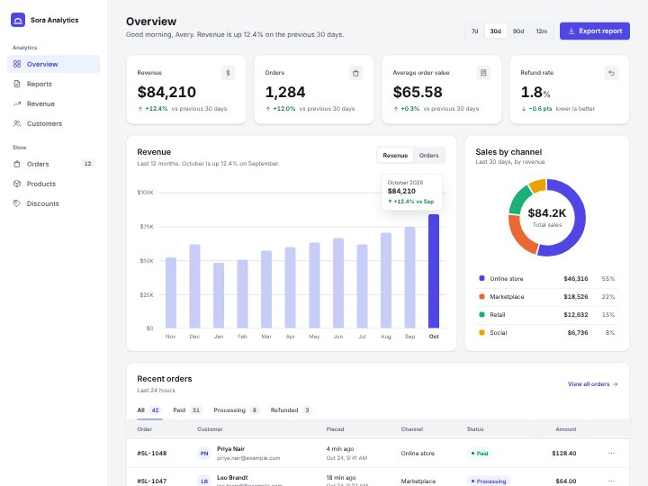</a><br><b>v1</b> · Analytics · <a href="skills/productcraft/examples/dashboard-v1.html">HTML</a> | <a href="docs/screens/dashboard-v2.jpg">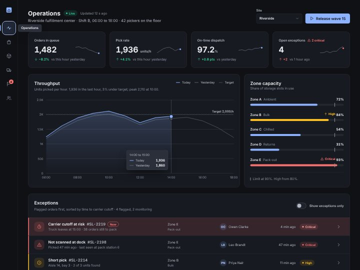</a><br><b>v2</b> · Operations (dark) · <a href="skills/productcraft/examples/dashboard-v2.html">HTML</a> | <a href="docs/screens/dashboard-v3.jpg">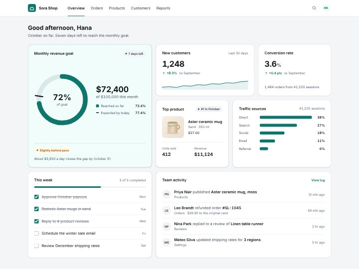</a><br><b>v3</b> · Store bento · <a href="skills/productcraft/examples/dashboard-v3.html">HTML</a> | <a href="docs/screens/dashboard-v4.jpg">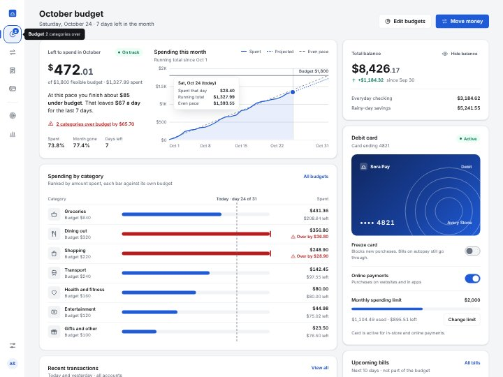</a><br><b>v4</b> · Personal finance · <a href="skills/productcraft/examples/dashboard-v4.html">HTML</a> |
| <a href="docs/screens/dashboard-v5.jpg">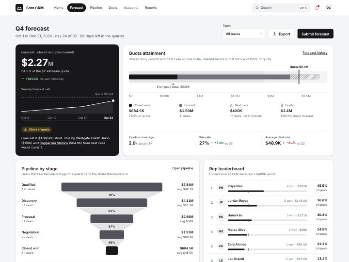</a><br><b>v5</b> · Sales CRM · <a href="skills/productcraft/examples/dashboard-v5.html">HTML</a> | <a href="docs/screens/dashboard-v6.jpg">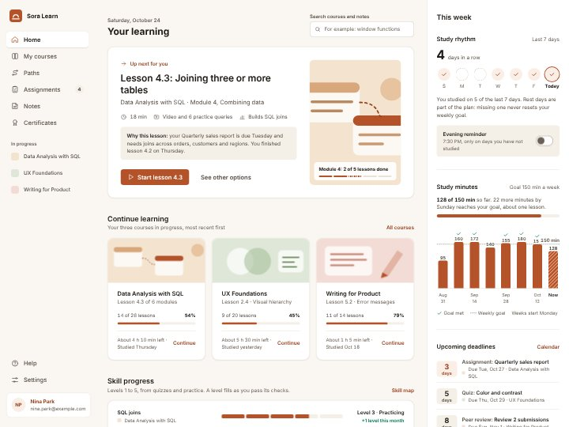</a><br><b>v6</b> · Learning · <a href="skills/productcraft/examples/dashboard-v6.html">HTML</a> | <a href="docs/screens/dashboard-v7.jpg">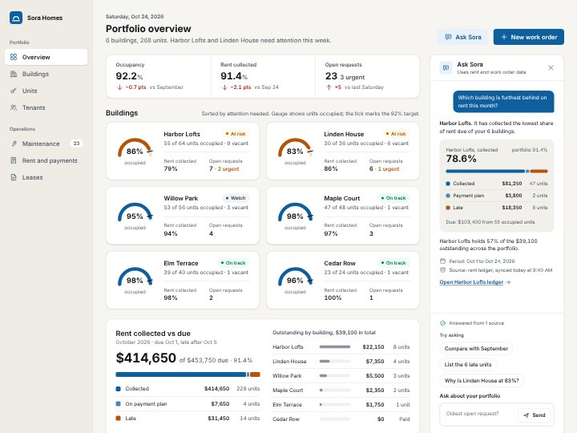</a><br><b>v7</b> · Property · <a href="skills/productcraft/examples/dashboard-v7.html">HTML</a> | <a href="docs/screens/dashboard-v8.jpg">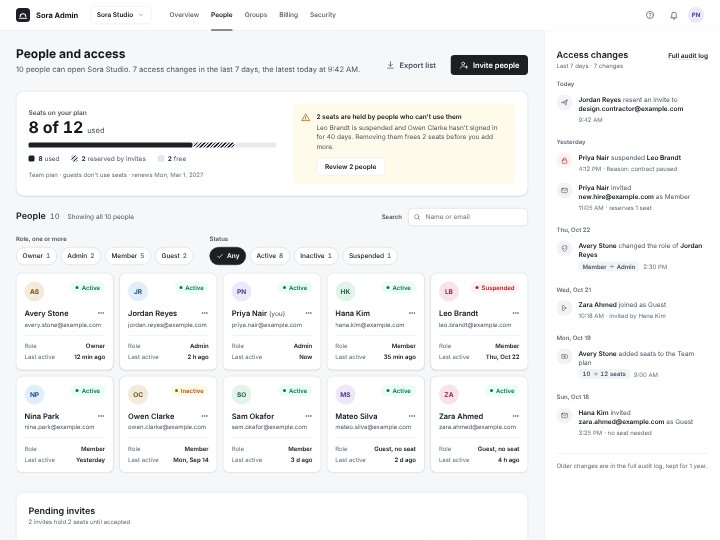</a><br><b>v8</b> · Workspace admin · <a href="skills/productcraft/examples/dashboard-v8.html">HTML</a> |
| <a href="docs/screens/dashboard-v9.jpg">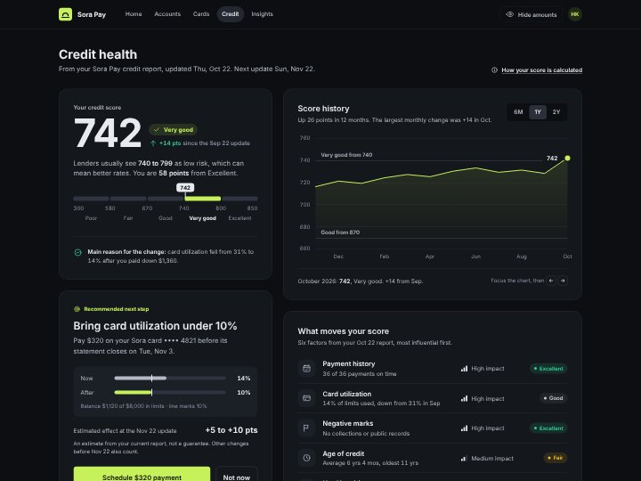</a><br><b>v9</b> · Credit score (dark) · <a href="skills/productcraft/examples/dashboard-v9.html">HTML</a> | <a href="docs/screens/dashboard-v10.jpg">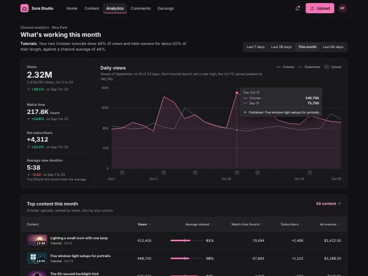</a><br><b>v10</b> · Creator (dark) · <a href="skills/productcraft/examples/dashboard-v10.html">HTML</a> | <a href="docs/screens/dashboard-v11.jpg">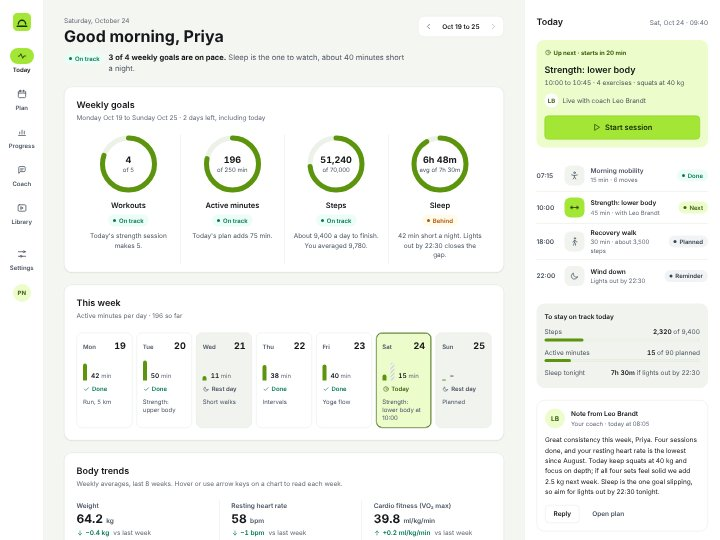</a><br><b>v11</b> · Fitness · <a href="skills/productcraft/examples/dashboard-v11.html">HTML</a> | <a href="docs/screens/dashboard-v12.jpg">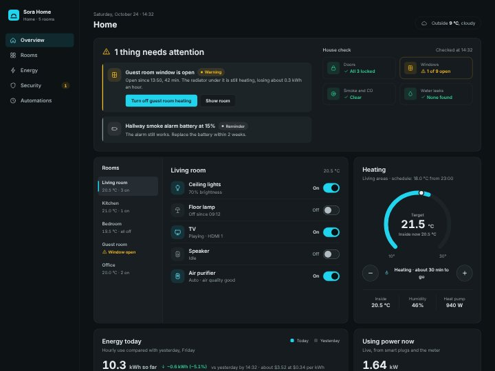</a><br><b>v12</b> · Smart home (dark) · <a href="skills/productcraft/examples/dashboard-v12.html">HTML</a> |
| <a href="docs/screens/dashboard-v13.jpg">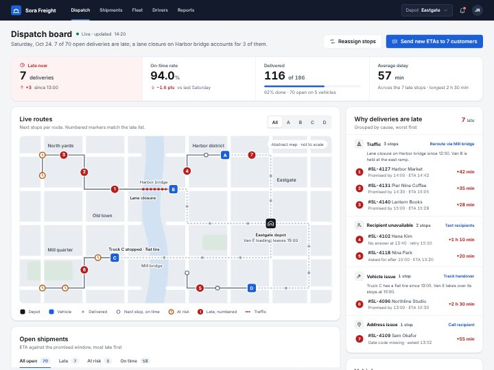</a><br><b>v13</b> · Logistics · <a href="skills/productcraft/examples/dashboard-v13.html">HTML</a> | <a href="docs/screens/dashboard-v14.jpg">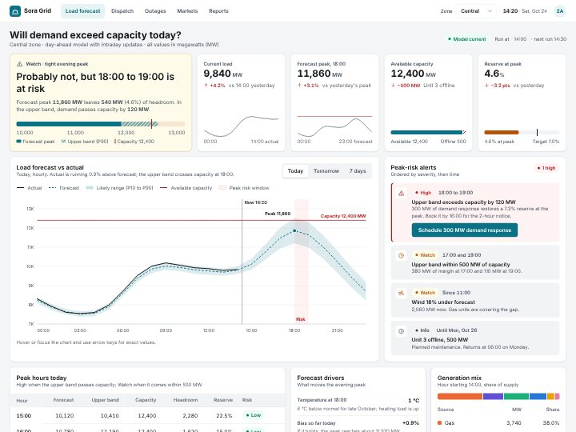</a><br><b>v14</b> · Grid forecast · <a href="skills/productcraft/examples/dashboard-v14.html">HTML</a> | <a href="docs/screens/dashboard-v15.jpg">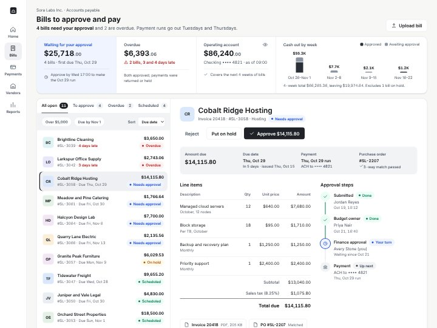</a><br><b>v15</b> · Accounts payable · <a href="skills/productcraft/examples/dashboard-v15.html">HTML</a> | <a href="docs/screens/dashboard-v16.jpg">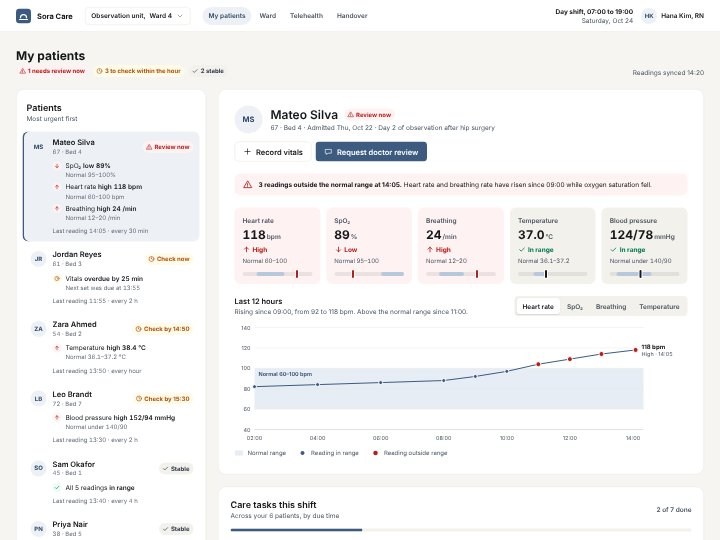</a><br><b>v16</b> · Clinic monitoring · <a href="skills/productcraft/examples/dashboard-v16.html">HTML</a> |

### Components and flows

|   |   |   |   |
|---|---|---|---|
| <a href="docs/screens/sign-in.jpg">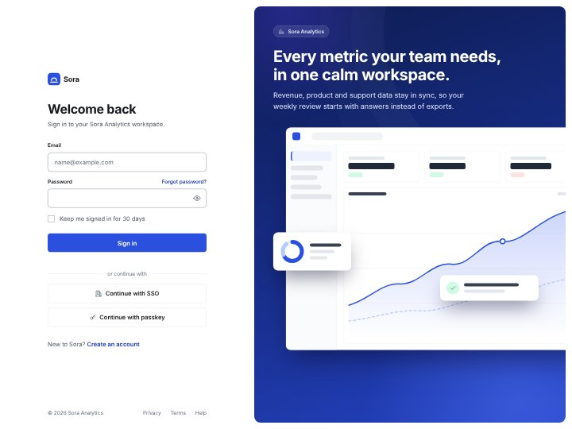</a><br><b>Sign-in</b> · split screen · <a href="skills/productcraft/examples/sign-in.html">HTML</a> | <a href="docs/screens/auth.jpg">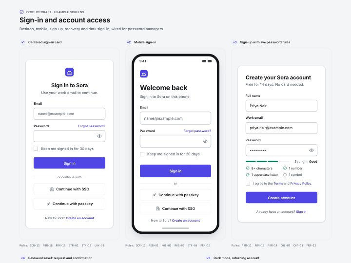</a><br><b>Account access</b> · v1–v5 · <a href="skills/productcraft/examples/auth.html">HTML</a> | <a href="docs/screens/auth-2.jpg">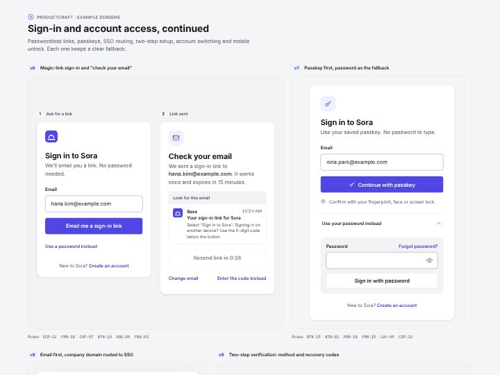</a><br><b>Account access</b> · v6–v11 · <a href="skills/productcraft/examples/auth-2.html">HTML</a> | <a href="docs/screens/otp.jpg">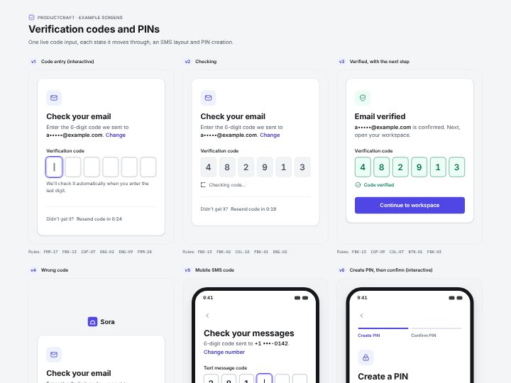</a><br><b>Codes and PINs</b> · 6 versions · <a href="skills/productcraft/examples/otp.html">HTML</a> |
| <a href="docs/screens/settings.jpg">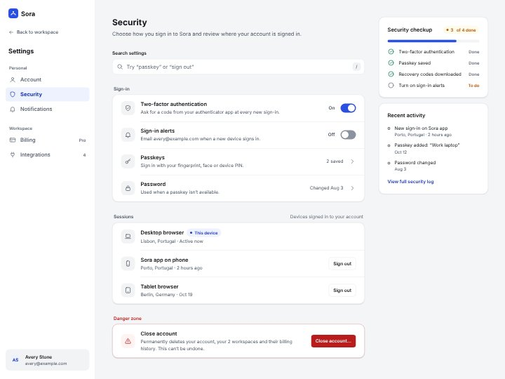</a><br><b>Settings</b> · security page · <a href="skills/productcraft/examples/settings.html">HTML</a> | <a href="docs/screens/navigation.jpg">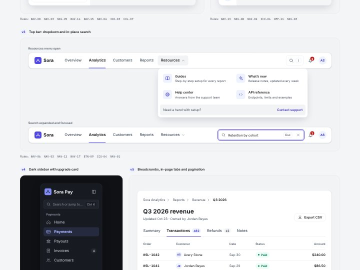</a><br><b>Navigation</b> · 5 versions · <a href="skills/productcraft/examples/navigation.html">HTML</a> | <a href="docs/screens/tab-bars.jpg">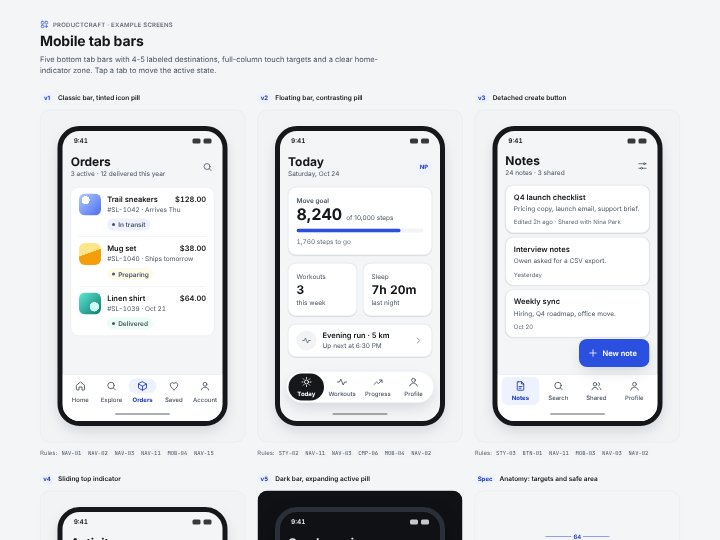</a><br><b>Tab bars</b> · 5 + spec · <a href="skills/productcraft/examples/tab-bars.html">HTML</a> | <a href="docs/screens/search.jpg">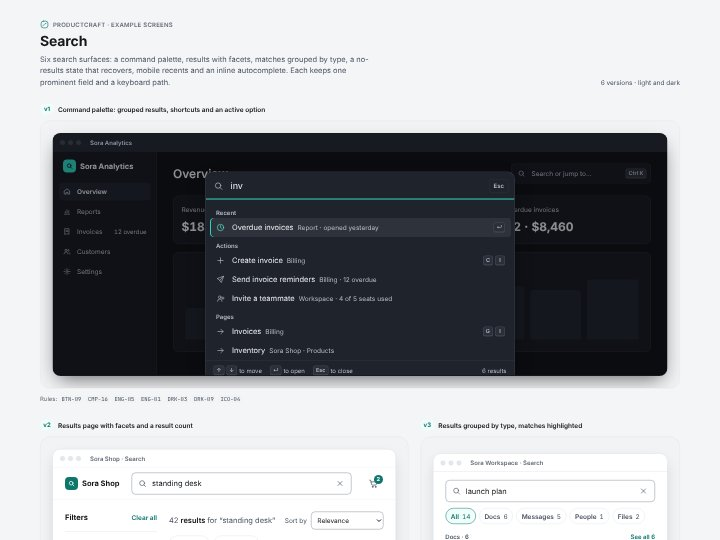</a><br><b>Search</b> · 6 versions · <a href="skills/productcraft/examples/search.html">HTML</a> |
| <a href="docs/screens/charts.jpg">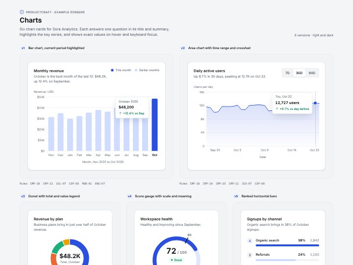</a><br><b>Charts</b> · v1–v6 · <a href="skills/productcraft/examples/charts.html">HTML</a> | <a href="docs/screens/charts-2.jpg">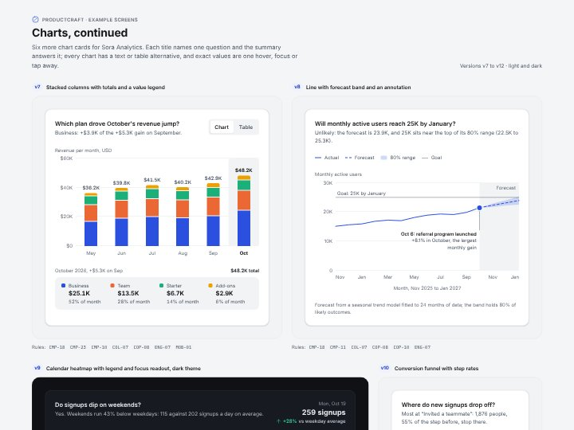</a><br><b>Charts</b> · v7–v12 · <a href="skills/productcraft/examples/charts-2.html">HTML</a> | <a href="docs/screens/cards.jpg">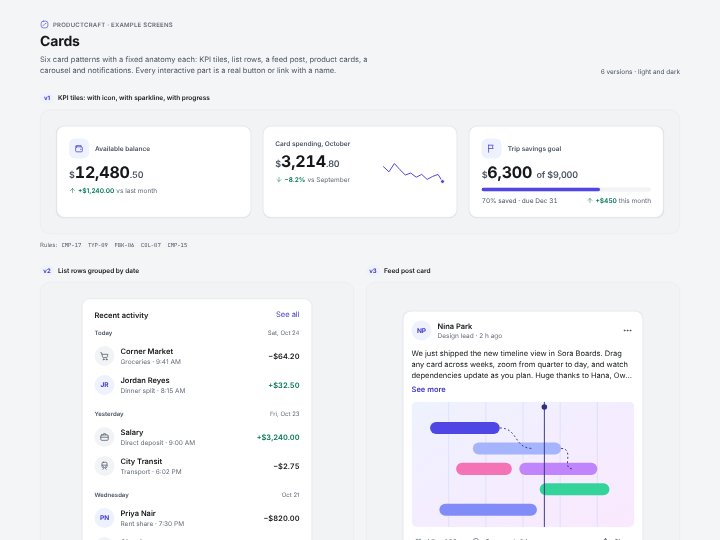</a><br><b>Cards</b> · v1–v6 · <a href="skills/productcraft/examples/cards.html">HTML</a> | <a href="docs/screens/cards-2.jpg">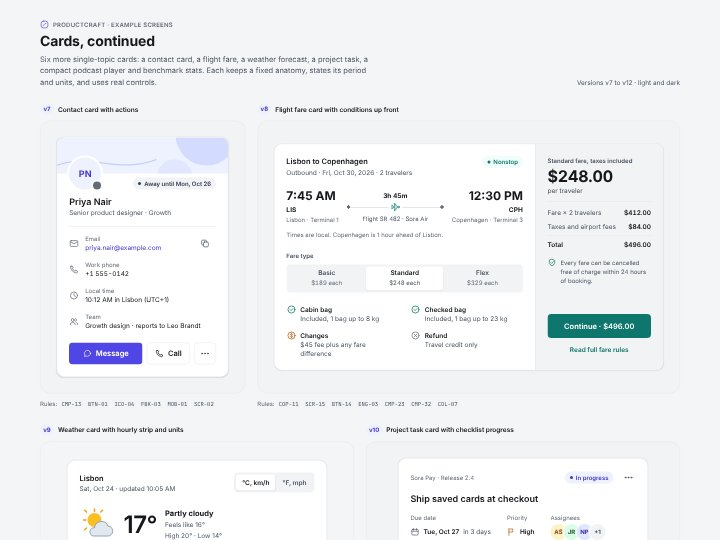</a><br><b>Cards</b> · v7–v12 · <a href="skills/productcraft/examples/cards-2.html">HTML</a> |
| <a href="docs/screens/tables.jpg">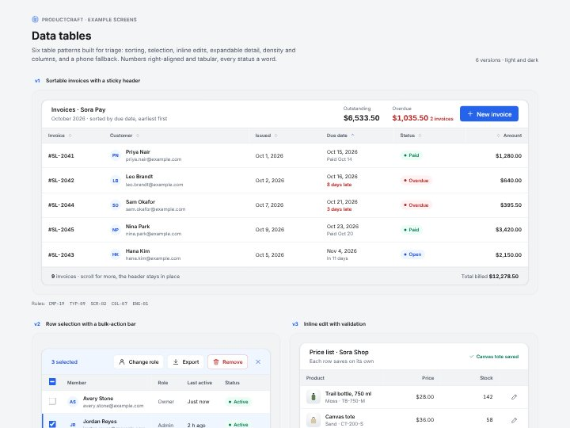</a><br><b>Data tables</b> · 6 versions · <a href="skills/productcraft/examples/tables.html">HTML</a> | <a href="docs/screens/calendar.jpg">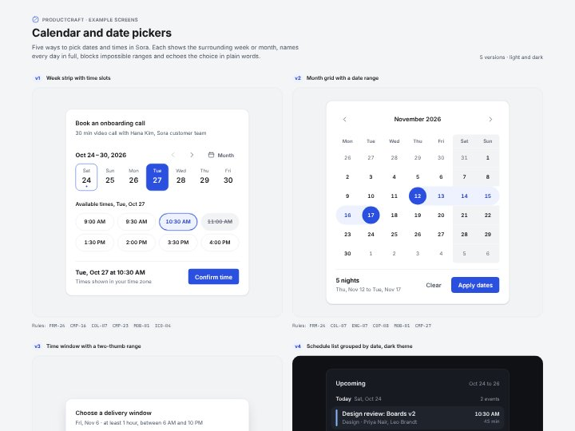</a><br><b>Calendars</b> · 5 versions · <a href="skills/productcraft/examples/calendar.html">HTML</a> | <a href="docs/screens/buttons.jpg">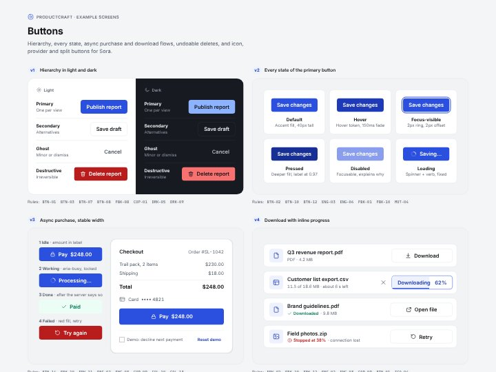</a><br><b>Buttons</b> · v1–v6 · <a href="skills/productcraft/examples/buttons.html">HTML</a> | <a href="docs/screens/buttons-2.jpg">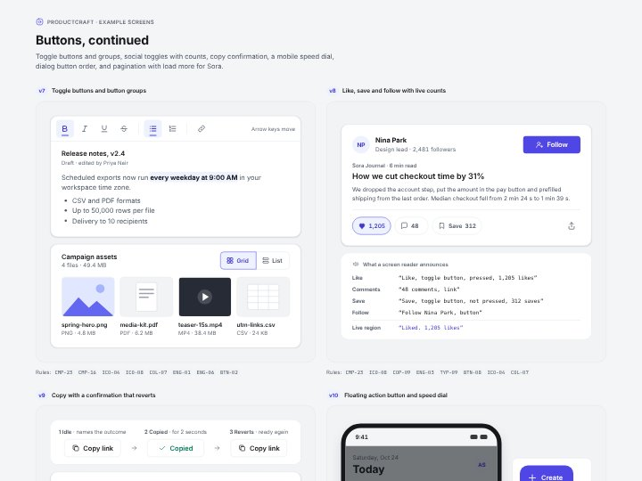</a><br><b>Buttons</b> · v7–v12 · <a href="skills/productcraft/examples/buttons-2.html">HTML</a> |
| <a href="docs/screens/form-controls.jpg">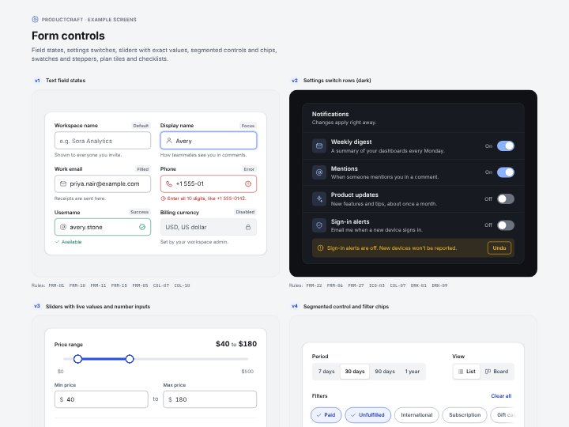</a><br><b>Form controls</b> · v1–v6 · <a href="skills/productcraft/examples/form-controls.html">HTML</a> | <a href="docs/screens/form-controls-2.jpg">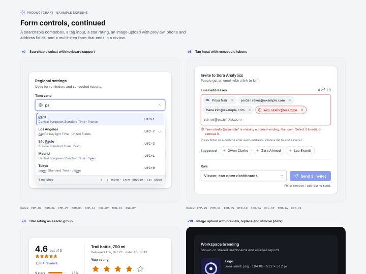</a><br><b>Form controls</b> · v7–v12 · <a href="skills/productcraft/examples/form-controls-2.html">HTML</a> | <a href="docs/screens/overlays.jpg">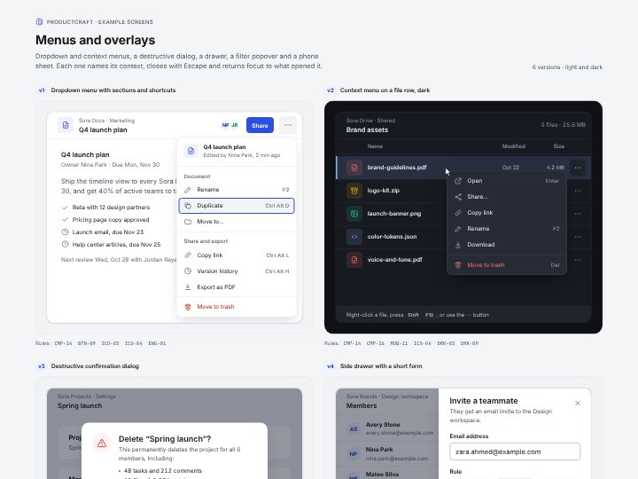</a><br><b>Menus and overlays</b> · 6 versions · <a href="skills/productcraft/examples/overlays.html">HTML</a> | <a href="docs/screens/feedback.jpg">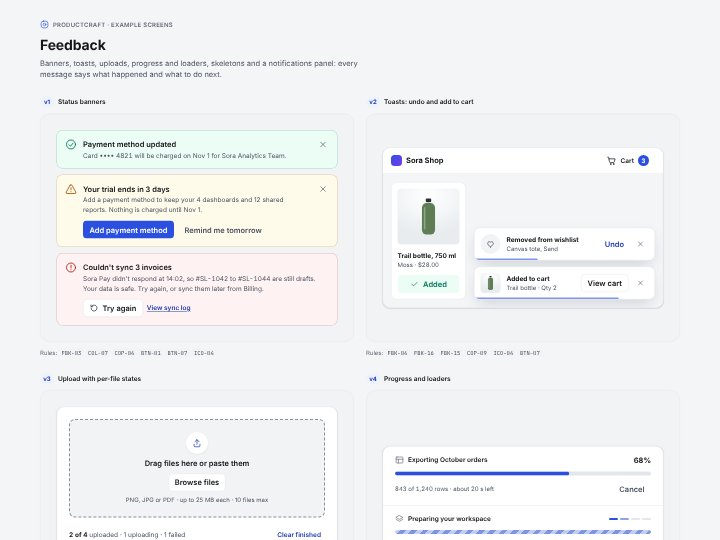</a><br><b>Feedback</b> · 6 versions · <a href="skills/productcraft/examples/feedback.html">HTML</a> |
| <a href="docs/screens/commerce.jpg">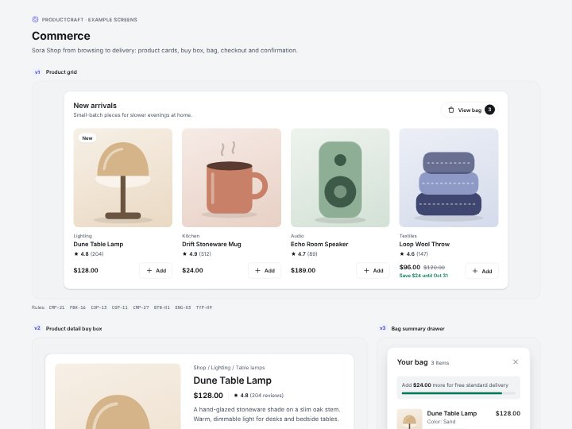</a><br><b>Commerce</b> · 5 versions · <a href="skills/productcraft/examples/commerce.html">HTML</a> | <a href="docs/screens/pricing.jpg">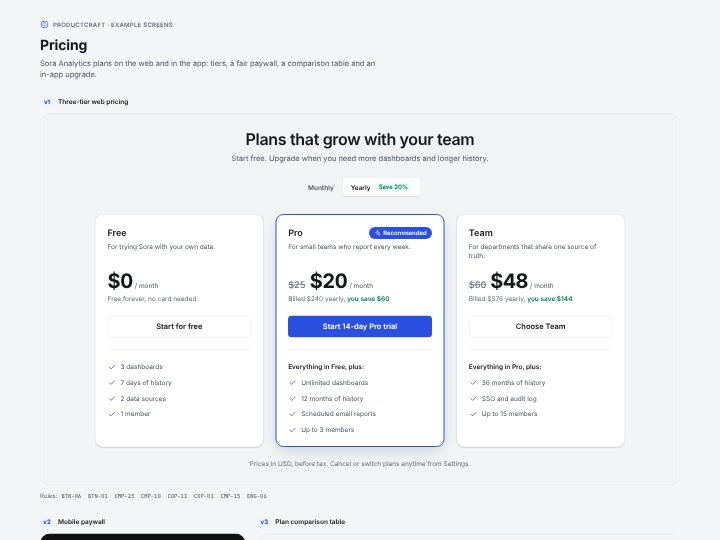</a><br><b>Pricing</b> · 4 versions · <a href="skills/productcraft/examples/pricing.html">HTML</a> | <a href="docs/screens/landing.jpg">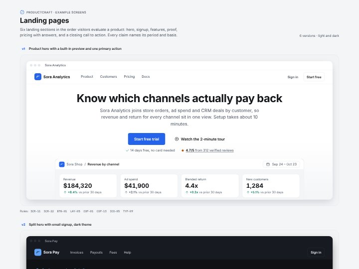</a><br><b>Landing pages</b> · 6 versions · <a href="skills/productcraft/examples/landing.html">HTML</a> | <a href="docs/screens/onboarding.jpg">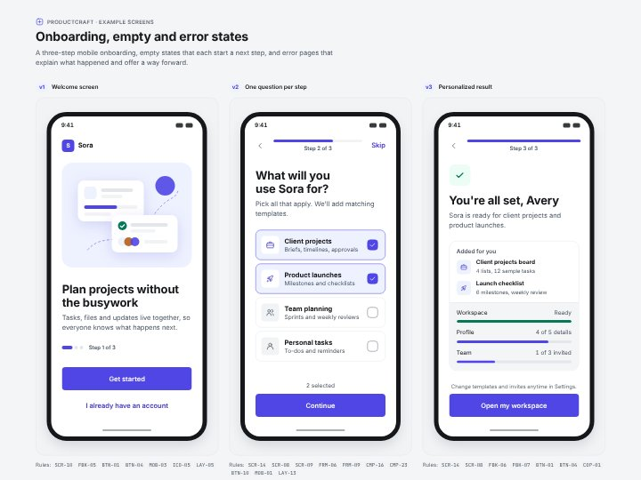</a><br><b>Onboarding and errors</b> · v1–v6 · <a href="skills/productcraft/examples/onboarding.html">HTML</a> |
| <a href="docs/screens/onboarding-2.jpg">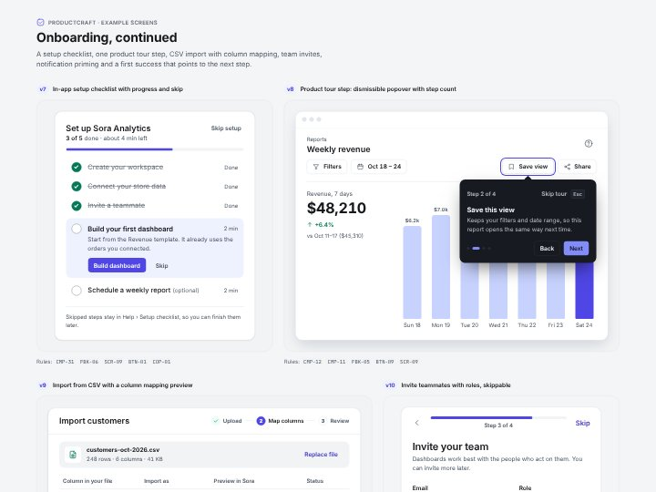</a><br><b>Onboarding</b> · v7–v12 · <a href="skills/productcraft/examples/onboarding-2.html">HTML</a> | <a href="docs/screens/mobile-apps.jpg">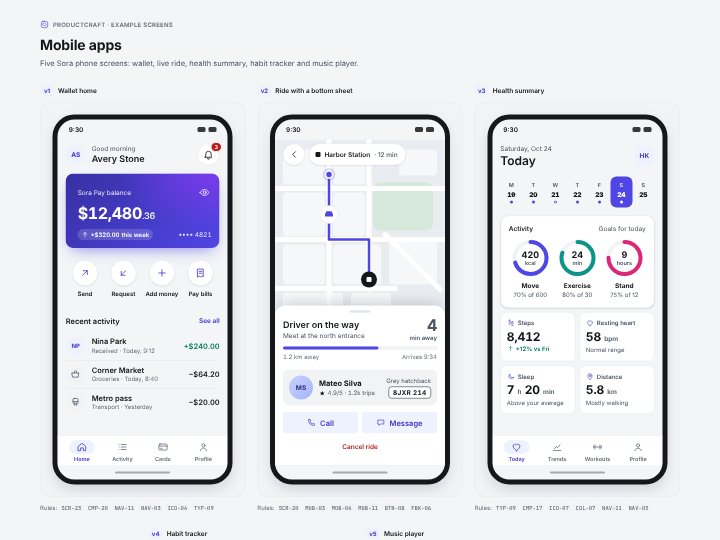</a><br><b>Mobile apps</b> · 5 versions · <a href="skills/productcraft/examples/mobile-apps.html">HTML</a> | <a href="docs/screens/messaging.jpg">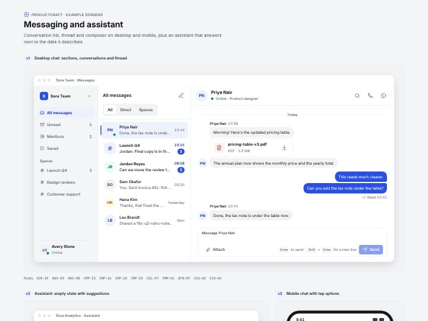</a><br><b>Messaging and assistant</b> · 4 versions · <a href="skills/productcraft/examples/messaging.html">HTML</a> | <a href="docs/screens/brand.jpg">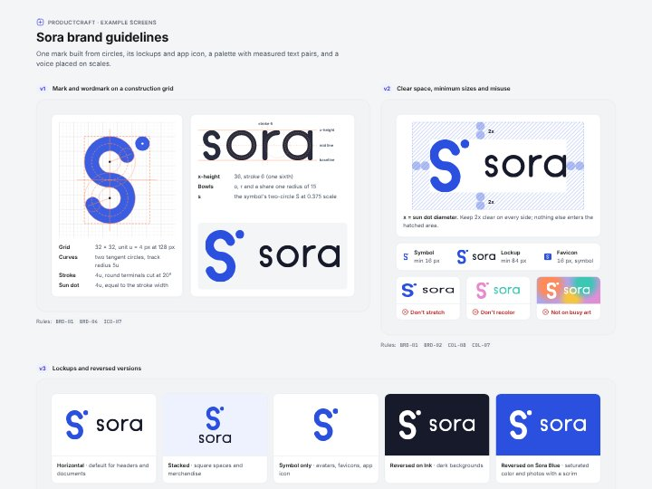</a><br><b>Brand guidelines</b> · 6 versions · <a href="skills/productcraft/examples/brand.html">HTML</a> |

## Install

### Claude Code

```text
/plugin marketplace add Sora-Labs2026/All-in-One-AI-Skills
/plugin install productcraft@sora-labs-skills
```

### Copy into a project

```bash
git clone --depth 1 https://github.com/Sora-Labs2026/All-in-One-AI-Skills.git /tmp/sora-skills

# Claude Code
mkdir -p .claude/skills && cp -R /tmp/sora-skills/skills/productcraft .claude/skills/

# Codex and other agents that read .agents/skills
mkdir -p .agents/skills && cp -R /tmp/sora-skills/skills/productcraft .agents/skills/
```

### ZIP upload to any coding-agent workspace

1. Download [`dist/productcraft.zip`](dist/productcraft.zip) and [`dist/PRODUCTCRAFT-WORKSPACE-SETUP-PROMPT.txt`](dist/PRODUCTCRAFT-WORKSPACE-SETUP-PROMPT.txt).
2. Upload the ZIP to your agent's workspace.
3. Paste the contents of the setup prompt. The agent extracts the ZIP safely, installs the skill locally to the project, runs the package checks and adds a short project rule so ProductCraft keeps applying to future work.

## Repository layout

```text
.
├── .claude-plugin/marketplace.json   # Claude Code plugin marketplace entry
├── .github/workflows/validate.yml    # runs package checks and tests on every push and PR
├── CHANGELOG.md
├── dist/                             # ready-to-upload ZIP + setup prompt for each skill
├── docs/screens/                     # screenshots of the reference screens (README galleries)
├── LICENSE                           # MIT
├── scripts/build_dist.py             # rebuilds or verifies dist/ from skills/
├── scripts/screenshots.cjs           # regenerates docs/screens/ from the example pages (Playwright)
└── skills/
    └── productcraft/                 # the ProductCraft skill (SKILL.md is the entry point)
```

## Validate

```bash
cd skills/productcraft
python3 scripts/check_package.py --root .
python3 -m unittest discover -s tests -v
python3 -m unittest discover -s modules/credential-shield/tests -v
python3 -m unittest discover -s modules/launchguard/tests -v
cd ../..
python3 scripts/build_dist.py --check
```

All of it uses the Python 3 standard library only. CI runs the same checks.

## Updating a skill

1. Edit files under `skills/<skill>/`.
2. Run `python3 scripts/build_dist.py` to rebuild the downloadable bundle in `dist/`.
3. If you changed a page in `skills/productcraft/examples/`, run `node scripts/screenshots.cjs <page>` (needs Playwright with Chromium) to refresh its screenshots in `docs/screens/`.
4. Run the validation commands above and commit `skills/`, `dist/` and `docs/` together.

## Principles

Every Sora Labs skill follows the same rules:

- Read the real project before changing it, and respect existing branding, conventions and uncommitted work.
- Use only the modules the task needs.
- Show *pending*, not *done*, until the server or provider has confirmed money, bookings, deletions or permission changes.
- Never fake scarcity, typing, progress, social proof or fees.
- Report only checks that actually ran. Scanners are advisory, and a clean scan is not a security pass.
- Leave production secrets, live data and deployments alone unless explicitly authorized.

## License

Released under the [MIT License](LICENSE). Anyone can use, copy, modify and share these skills, including for commercial work, as long as the copyright and license notice stay with the copies.

© 2026 Sora Labs
