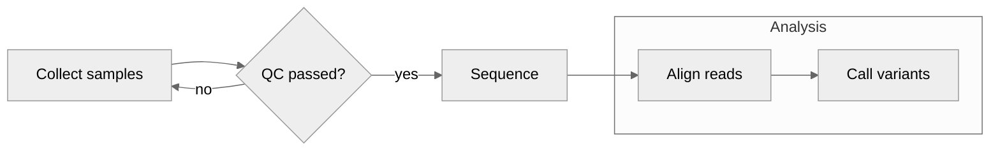
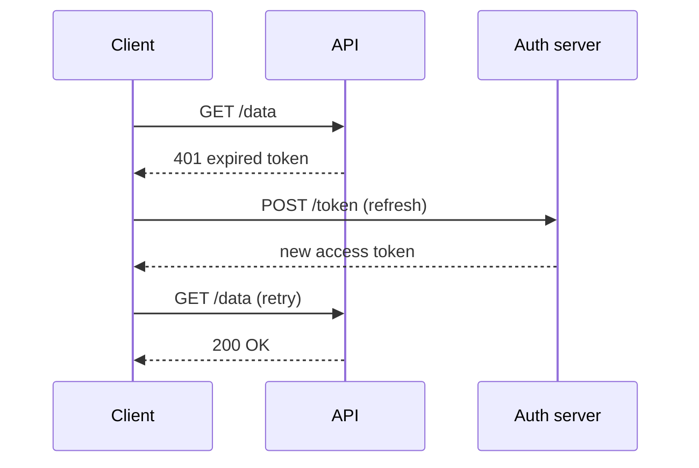
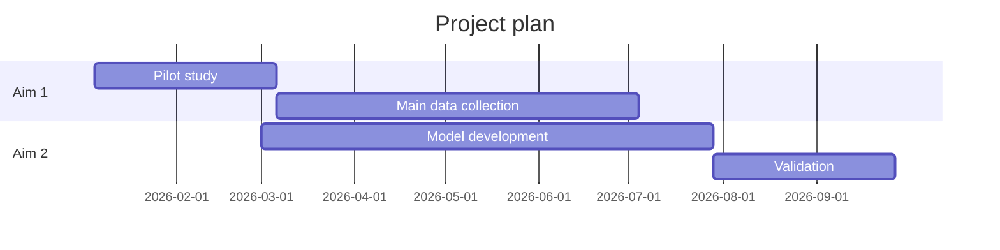

# Schematics and diagrams: Mermaid, Graphviz and TikZ

Read this when a document, paper, README, talk or poster needs a diagram: a workflow, study flow, pipeline, architecture, sequence of interactions, state machine, timeline, data model or concept map. Charts of data are code-generated plots (`../../data-engineering/references/plotting.md` and `../../data-engineering/references/publication-figures.md`). Engineering docs already keep diagrams as text next to the code (`../../engineering-practices/references/docs-and-decisions.md`); this reference covers choosing, writing, rendering and checking them.

## Choose the form from the question

| The reader needs to see | Diagram |
|---|---|
| Steps, decisions, a pipeline or study flow | Flowchart |
| Who calls whom, in what order | Sequence diagram |
| States and the events that move between them | State diagram |
| Tables and relationships | Entity-relationship diagram |
| Classes, types and their relations | Class diagram |
| Systems, containers and their connections | C4-style context or container diagram, or an architecture diagram |
| Work over time, dependencies | Gantt chart |
| Events in order | Timeline |
| A hierarchy of ideas | Mind map or tree |
| Flows with magnitudes | Sankey diagram |
| Two-axis prioritization | Quadrant chart |
| Measured data | A plot made with code, not a diagram tool |

Draw the level the reader needs. One overview plus focused detail diagrams beats one diagram with everything.

## Choose the tool from the destination

| Tool | Best for | Notes |
|---|---|---|
| Mermaid | Markdown docs, READMEs, wikis, issue trackers, quick paper figures | Renders natively on GitHub and GitLab; text diffs well; limited layout control |
| Graphviz (DOT) | Large graphs with automatic layout (dependency graphs, citation networks, ontologies) | `dot -Tsvg in.dot -o out.svg`; good at many nodes |
| PlantUML or D2 | UML-heavy or styled architecture diagrams | PlantUML needs Java; D2 has strong layout engines |
| TikZ | LaTeX papers needing exact placement, math in labels and the paper's fonts | Compiles with the paper; steep but precise |
| draw.io (diagrams.net), Inkscape | Hand-tuned figures, editing by non-programmers | Keep the editable source file (`.drawio`, `.svg`) in the repository |
| schemdraw, matplotlib | Circuits, small technical schematics, anything data-driven | Code-generated, reproducible |

Whatever the tool, keep the source next to the document and regenerate the image from it; never keep only a PNG.

## Conventions for scientific schematics

- One meaning per visual element: if solid arrows mean data flow, do not also use them for control flow. Add a legend when there is more than one kind.
- One main direction (left to right or top to bottom), aligned elements, minimal crossings.
- Short labels in the paper's terminology; units on quantities; no text smaller than the figure text size at final print size.
- Never encode meaning by color alone; add shape, line style or labels, and check in grayscale.
- Export vector formats (SVG or PDF) for papers and posters; embed or outline fonts as the venue requires.
- Generative image models are not suitable for research schematics: they misspell labels, invent structure and cannot be edited precisely, and many publishers restrict or forbid AI-generated images in papers. Never use them for data, micrographs or results. If a user wants generated artwork for a cover or illustration, check the venue's policy and disclose it.

## Mermaid essentials

Mermaid's major version in 2025-2026 is 11. Renderers lag behind the library (GitHub, GitLab, documentation sites and editors each bundle their own version), and several diagram types are still marked beta (`xychart-beta`, `sankey-beta`, `block-beta`, `packet-beta`, `architecture-beta`, `radar-beta`, `treemap-beta`). Test in the renderer the reader will use.

A flowchart with grouping and an accessible title and description:



A sequence diagram:



A Gantt chart for a proposal or project plan:



**Accessibility.** `accTitle` and `accDescr` are supported by most diagram types and become the SVG's accessible name and description. For types that ignore them, put a one-sentence description in the text right before the diagram. The description says what the diagram shows and the point the reader should take from it.

**Pitfalls and fixes:**

| Problem | Fix |
|---|---|
| A node labeled `end` breaks a flowchart | Quote and capitalize it: `done["End"]` |
| Parentheses, brackets, colons or `#` in labels break parsing | Put the label in double quotes: `a["Dose (mg/kg)"]` |
| An edge like `A---oB` draws a circle end | Space or rename: `A --- oB` or use a different id |
| Line breaks in labels | `<br>` inside a quoted label |
| `%%{init: ...}%%` directives | Still work, but frontmatter `config:` is the current way to set theme and options |
| Diagram renders locally but not on the hosting site | The site bundles an older Mermaid; avoid beta types or render to SVG |
| Click handlers or HTML labels missing on GitHub | GitHub disables them for security; do not rely on interactivity |
| Unreadable diagram | Keep to about a dozen nodes; split into overview and detail; use short labels and stable ids |
| Colors unreadable in dark mode | Prefer the default or neutral theme; if you add `classDef` colors, set both fill and text color and check light and dark themes |

## Rendering and checking

```bash
# Mermaid to SVG or PDF (Node.js; downloads a headless Chromium on first install, so ask first)
npx -p @mermaid-js/mermaid-cli mmdc -i pipeline.mmd -o pipeline.svg -t neutral -b transparent
npx -p @mermaid-js/mermaid-cli mmdc -i pipeline.mmd -o pipeline.pdf --pdfFit

# Graphviz
dot -Tsvg deps.dot -o deps.svg

# SVG to PDF for LaTeX
rsvg-convert -f pdf -o pipeline.pdf pipeline.svg
```

Pin the mermaid-cli version in the project once it works, so figures do not change on the next install.

A minimal TikZ diagram for a LaTeX paper:

```latex
\usetikzlibrary{positioning,arrows.meta}
\begin{tikzpicture}[node distance=12mm, box/.style={draw, rounded corners, inner sep=4pt}, >={Stealth}]
  \node[box] (in) {Raw data};
  \node[box, right=of in] (clean) {Cleaning};
  \node[box, right=of clean] (model) {Model};
  \draw[->] (in) -- (clean);
  \draw[->] (clean) -- (model);
\end{tikzpicture}
```

Always look at the rendered result: open the SVG or PDF, or render a PNG and view it, at the size it will appear. Check text size, overlaps, arrow directions and that every label is spelled right. In the target (GitHub preview, the compiled PDF), check once more.

## Checks (done when)

- [ ] The diagram type matches the question; one diagram per level of detail.
- [ ] Source text or editable file is stored next to the document; images regenerate from it.
- [ ] Accessible title and description present (or a text description beside it); meaning not carried by color alone.
- [ ] Rendered in the reader's renderer and inspected at final size; labels correct and legible.
- [ ] No AI-generated imagery in research figures; vector output where the venue wants it.
